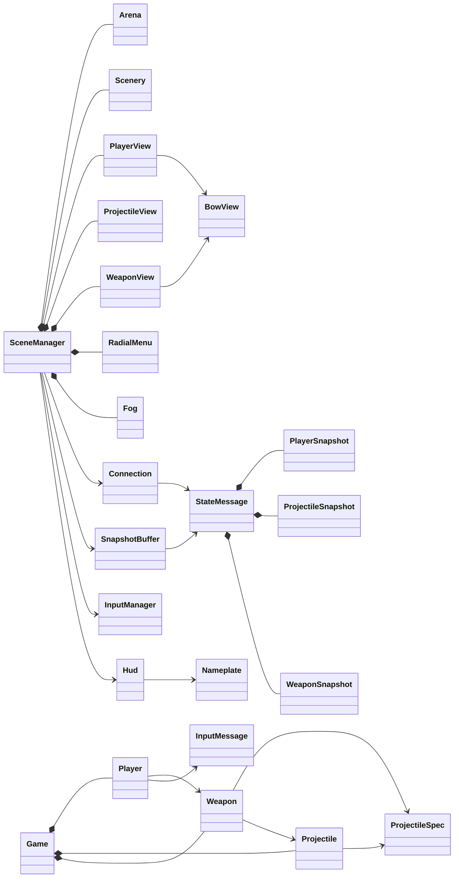
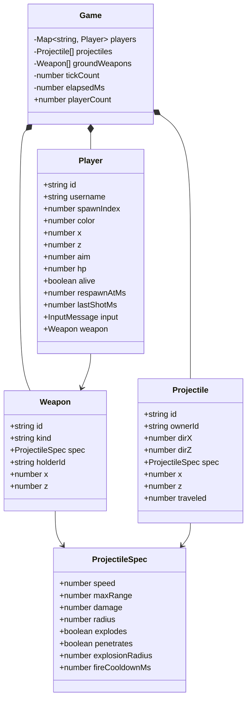
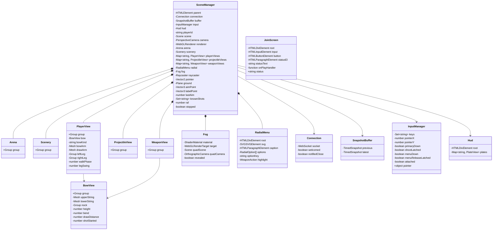
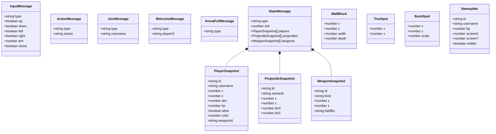

# Class map

Diagram of the game's classes and the message shapes they store. Update this file in the same change whenever a class, interface, or field is added, removed, or renamed.

`+` is public. `−` is private. An arrow means the left type holds or uses the right one. Methods are not listed.

`Player.weapon`, `weaponId`, and `heldBy` are null when a player is unarmed or a weapon is on the ground.

## Ownership

## Server

`server/src/Game.ts`, `server/src/Player.ts`, `server/src/Weapon.ts`, `server/src/Projectile.ts`

Held weapons stay on the player. `groundWeapons` is only the ones lying in the arena. `Weapon` creates each `Projectile` from its spec.

## Client

`client/src/scene/SceneManager.ts` owns the other client objects.

## Messages

Interfaces, not classes. `Player` stores `InputMessage`. `Connection` and `SnapshotBuffer` carry `StateMessage`. `Hud` draws `Nameplate`. `RadialOption` is the menu entry `{ id, label }`. `WallBlock`, `TreeSpot`, and `BushSpot` are the static map. Walls and tree trunks block hunters, arrows, and sight. Bushes do not. Sight is a cone in front of the hunter.

