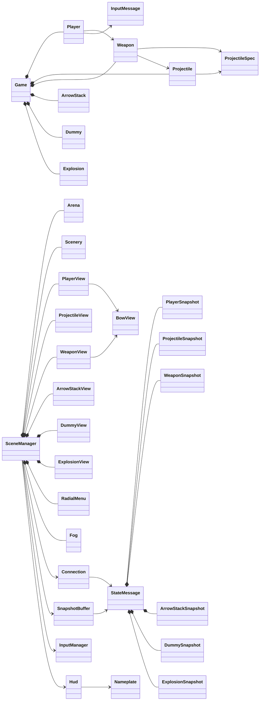
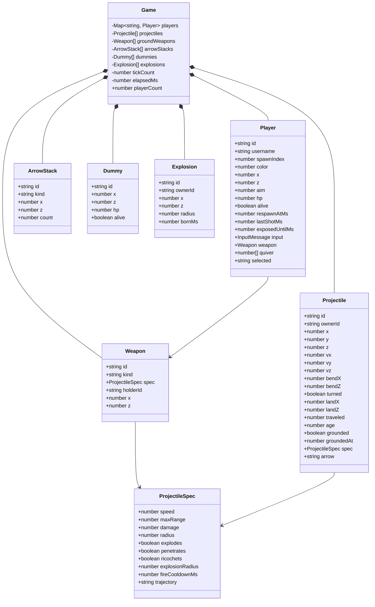
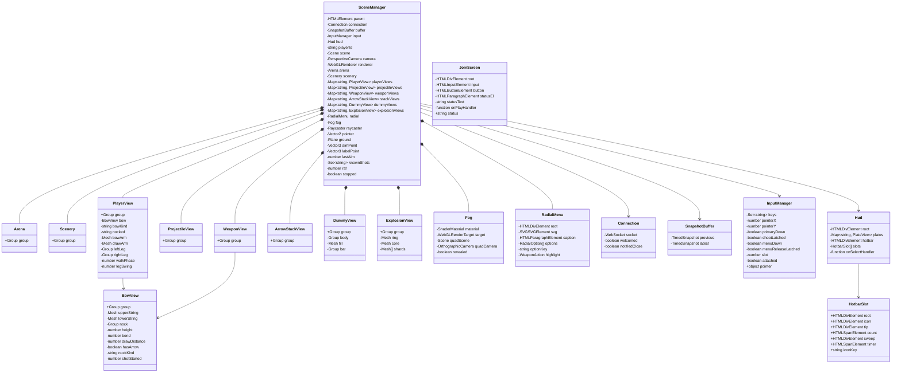
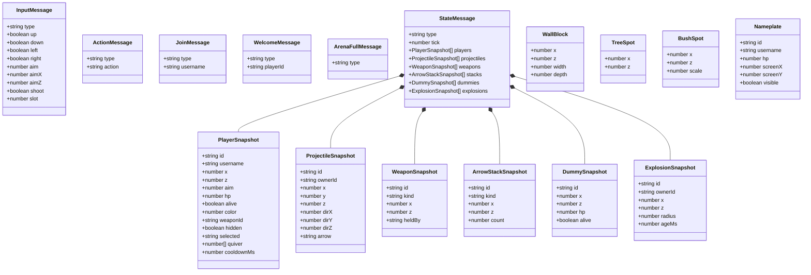

# Class map

Diagram of the game's classes and the message shapes they store. Update this file in the same change whenever a class, interface, or field is added, removed, or renamed.

`+` is public. `−` is private. An arrow means the left type holds or uses the right one. Methods are not listed.

`Player.weapon`, `weaponId`, and `heldBy` are null when a player is unarmed or a weapon is on the ground.

## Ownership

## Server

`server/src/Game.ts`, `server/src/Player.ts`, `server/src/Weapon.ts`, `server/src/Projectile.ts`, `server/src/ArrowStack.ts`, `server/src/Dummy.ts`, `server/src/Explosion.ts`

Held weapons stay on the player. `groundWeapons` is only the ones lying in the arena. `arrowStacks` are piles of ricochet, explosion, bodkin, and flare arrows. Walking over a pile adds them to `quiver`. `selected` is `normal` for the unlimited arrow, or one of those four. Ricochet arrows bounce off walls, trunks, and the arena edge. Explosion arrows burst on the ground, on those surfaces, on hunters, and on dummies, and leave a short `Explosion`. The shooter keeps seeing that arrow and its blast after they leave the view cone. Bodkin arrows pass through walls and trunks. Flare arrows fly slowly and light a full circle, blocked by walls and trunks, until they land. `Dummy` targets stand along the walls and across the arena. They take arrow and blast damage and stay fallen at 0 hp. `Weapon` creates each `Projectile` from the bow and the selected arrow. A shortbow flies flat along the facing and drops. A longbow lofts onto the clicked ground and can pass over low cover. A recurve does the same with a longer reach, and bends once to get around a wall. The bow still sets the time between shots.

## Client

`client/src/scene/SceneManager.ts` owns the other client objects.

## Messages

Interfaces, not classes. `Player` stores `InputMessage`. `Connection` and `SnapshotBuffer` carry `StateMessage`. `Hud` draws `Nameplate` and the five hotbar squares. `RadialOption` is the menu entry `{ id, label }`. `WallBlock`, `TreeSpot`, and `BushSpot` are the static map. Walls and tree trunks block hunters, arrows, and sight. Bushes do not. A hunter inside a bush is hidden from everyone else until they loose an arrow, which reveals them for two seconds. `PlayerSnapshot.hidden` is that state for the hunter's own client. Sight is a cone in front of the hunter. `InputMessage.slot` asks for the bow (`0`) or a quiver slot (`1` to `4`). `selected` is the arrow that will be shot. `quiver` counts ricochet, explosion, bodkin, and flare. Normal arrows are unlimited. `cooldownMs` is the wait left on the bow. A flying flare reveals hunters, arrows, bows, stacks, and dummies inside its circle, even outside the view cone. `DummySnapshot` is a straw target. `ExplosionSnapshot.ageMs` drives the blast animation.

